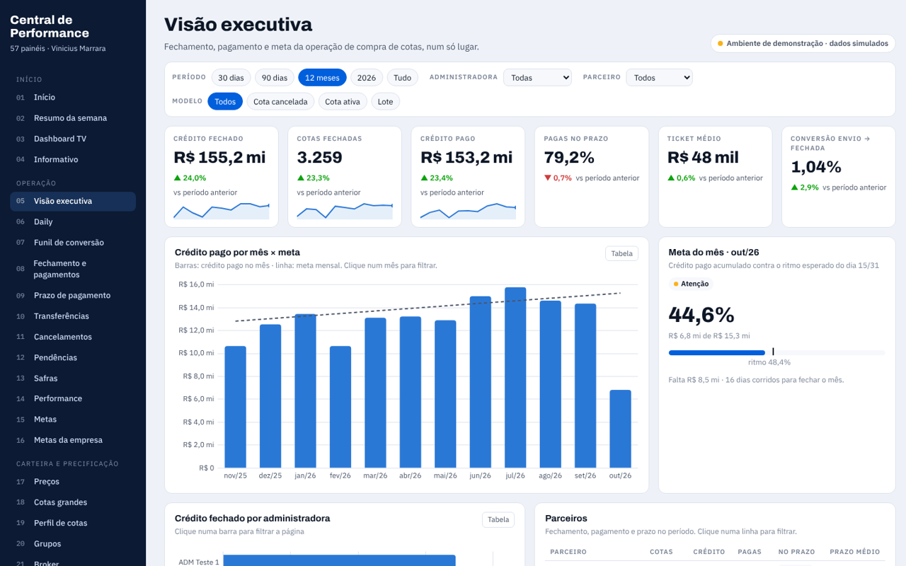

# Central de Performance

Versão completa, em portfólio, da plataforma de painéis que construí para a operação de uma plataforma de compra de cotas de consórcio: **57 páginas navegáveis com dados 100% simulados**.

**[Abrir o painel →](https://vinimarrara.github.io/central-de-performance/)**

## Páginas
- **Início:** início com atalhos, resumo da semana, dashboard para TV e informativo
- **Operação:** visão executiva, daily, funil, fechamento e pagamentos, prazo de pagamento, transferências, cancelamentos, pendências, safras, performance, metas e metas da empresa
- **Carteira e precificação:** preços, cotas grandes, perfil de cotas, grupos e broker (propostas lidas de extratos em PDF)
- **Relacionamento:** experiência do cliente, NPS, CSAT do chat, atendimentos, transbordos, Reclame Aqui, régua de comunicação, WhatsApp/Meta API, opt-in e e-mail (SendGrid)
- **Captação:** formulários e formulário do site
- **Parcerias:** dashboards de parceria, central de administradoras, bases das administradoras e assessorias
- **Dados e sistemas:** relatórios diários, exportação em CSV, tickets (Jira), ações operacionais, incidentes, usuários e acessos, qualidade do cadastro
- **Gestão do time:** bloco de notas, to-dos, reuniões e atas, desenvolvimento, carreira, escopo (RACI), 9 Box, feedback, pesquisa de clima, pontos de atenção, férias e escala presencial

Filtros de período, administradora, parceiro e modelo no topo; clique nos gráficos para filtrar os outros visuais; "Tabela" mostra os números de cada visual.

## Sobre os dados
Todos os números, nomes de administradoras, parceiros, pessoas, clientes, contratos, grupos, tickets e protocolos são fictícios, gerados por simulação no próprio navegador. O original roda em Google Apps Script sobre uma base no BigQuery alimentada por pipelines em Python.

---
Parte do portfólio de [Vinicius Marrara](https://vinimarrara.github.io/) · [LinkedIn](https://www.linkedin.com/in/vinicius-marrara-dos-santos-423b6973)
